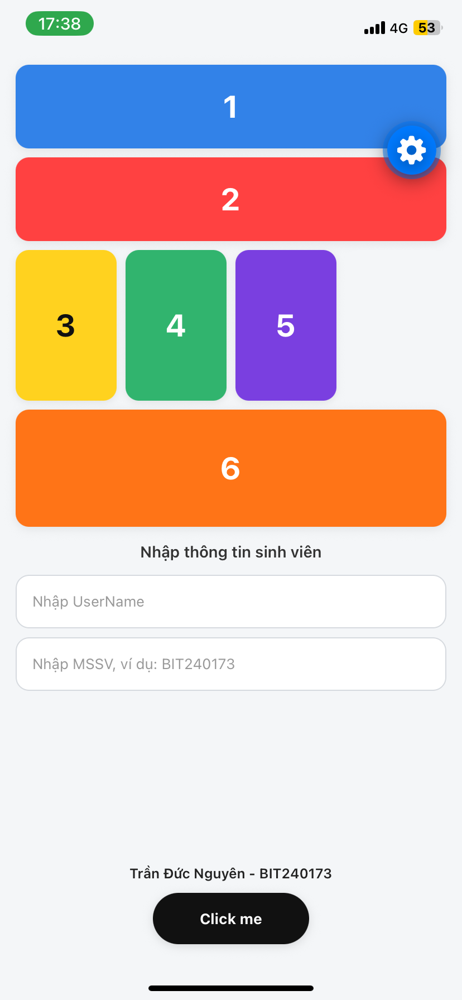
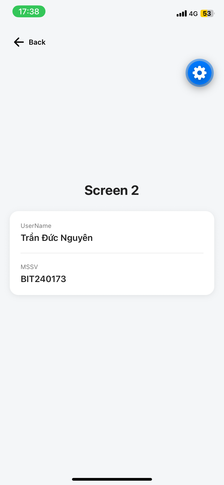

# PTUDDD-Bai2

Ứng dụng React Native (Expo) gồm 2 màn hình: nhập thông tin sinh viên (UserName, MSSV) và hiển thị lại thông tin ở Screen 2.

## Giao diện

### Màn hình chính


### Screen 2


## Cách chạy

```bash
npm install
npx expo start
```
Quét mã QR bằng Expo Go trên điện thoại.